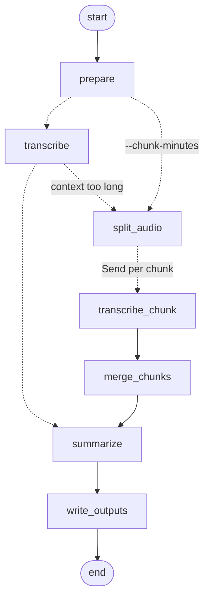

# transcribe

Transcribes recorded audio (MP3 and other files) with Mistral's
`voxtral-mini-transcribe-3-0` model. It is a small example of how LangChain and
LangGraph fit around a speech-to-text API.

> **Not yet run against the live API.** Everything here is tested against a mocked
> Mistral endpoint. See [Live checks still pending](#live-checks-still-pending).

## Setup

Requires Python 3.11+, [uv](https://docs.astral.sh/uv/), and network access to
`https://api.mistral.ai`. `ffmpeg`/`ffprobe` are needed only for splitting long files.

```bash
uv sync
export MISTRAL_API_KEY='...'   # never commit a real key
```

## Usage

```bash
# Transcript plus a summary; language is auto-detected
uv run transcribe --file meeting.mp3

# French meeting with timestamps, speaker labels and spelling hints
uv run transcribe --file meeting.mp3 --language fr --diarize \
  --bias "PKCS#11" --bias "Northwind Labs"

# Show text while it is transcribed
uv run transcribe --file meeting.mp3 --stream

# Audio at an HTTPS URL, or already uploaded to Mistral
uv run transcribe --url "https://your-host.example/meeting.mp3" --timestamps
uv run transcribe --file-id ACTUAL_FILE_ID --no-summary

# Split a long local file into 10-minute chunks transcribed in parallel
uv run transcribe --file lecture.mp3 --chunk-minutes 10
```

Files are written to `transcripts/` (change with `--out-dir`) and are never overwritten:

| File | Content |
|---|---|
| `<name>.transcript.json` | The provider's response, unchanged (or the merged result for a chunked run) |
| `<name>.job.json` | Job record: input hash, options, requested and returned model, timings, estimated cost |
| `<name>.txt` | Plain transcript |
| `<name>.srt`, `<name>.vtt` | Segment-aligned captions, with `--timestamps` or `--diarize` |
| `<name>.summary.md` | Title, summary and key points, unless `--no-summary` |
| `<name>.chunks.json` | Each chunk's raw response, for chunked runs |

If a run fails, nothing is written. Re-running the same command resumes it, so
chunks that already succeeded are not transcribed (or billed) again.

## How the frameworks are used



**LangGraph** (`src/transcribe/graph.py`)

- `StateGraph` over a typed state, with conditional edges for routing.
- Map-reduce with the `Send` API: one `transcribe_chunk` task per chunk, run in
  parallel and collected by a reducer on `chunk_results`.
- `RetryPolicy` on the transcription nodes, limited to HTTP 429 and 5xx. Timeouts
  are not retried because the request may already have been processed and billed.
- A `SqliteSaver` checkpointer (`.transcribe/checkpoints.sqlite`) for resuming.
- `get_stream_writer()` forwards streaming text deltas as custom events; the CLI
  reads them with `graph.stream(stream_mode=["updates", "custom"])`.

**LangChain**

- `VoxtralTranscriptionParser` (`parser.py`) is a `BaseBlobParser`, so Voxtral can
  be used with LangChain loaders. It yields one `Document` per segment, with
  timings and speaker in the metadata:

  ```python
  from langchain_core.document_loaders import Blob
  from transcribe.parser import VoxtralTranscriptionParser
  from transcribe.voxtral_client import VoxtralClient

  with VoxtralClient(api_key) as client:
      docs = VoxtralTranscriptionParser(client, diarize=True).parse(Blob.from_path("meeting.mp3"))
  ```

- The summary (`chains.py`) is an LCEL chain:
  `ChatPromptTemplate | ChatMistralAI.with_structured_output(Summary)`. The graph
  feeds it the same `Document`s. A failed summary is reported as a warning and
  never discards the transcript.

The HTTP transport (`voxtral_client.py`) is the reference `httpx` client from the
implementation guide, unchanged. There is no ready-made LangChain integration for
Voxtral transcription, so the parser wraps this client.

## Behaviour worth knowing

- **Timestamps are per segment.** Word timestamps fail on Voxtral 3, so captions
  are segment-aligned.
- **Chunking is opt-in.** One request per file is the default. The file is split
  only with `--chunk-minutes`, or when the API rejects it as exceeding the model
  context. Chunks are fixed-length windows with a 5-second overlap, not cut at
  silences; duplicates in the overlap are removed using segment timings.
- **Speaker labels are local to a chunk.** In chunked runs they are written as
  `c00:speaker_1`, `c01:speaker_1` and are never merged across chunks. They are
  anonymous labels, not identities.
- **Chunking and resume by content apply to local files only.** A URL or file ID
  that is too long fails with an explanation.
- **Limits are application policy.** The 100 MiB cap (`--max-bytes`) and timeouts
  are defaults of this app; Mistral's real size and duration limits are unpublished.
- **Cost is an estimate:** USD 0.0035 per audio minute, from the model card on
  22 November 2026. The summary's chat-model cost is not included.
- `TRANSCRIBE_MODEL` and `TRANSCRIBE_SUMMARY_MODEL` override the model IDs
  (defaults `voxtral-mini-transcribe-3-0` and `mistral-small-latest`). The app
  never switches models on its own.

## Tests

```bash
uv run pytest
uv run ruff check .
```

All tests run offline against `httpx.MockTransport`. The chunking tests split a
real generated MP3 with ffmpeg and are skipped when ffmpeg is missing.

## Live checks still pending

These need an API key and network access, and have not been done:

1. The workspace can access `voxtral-mini-transcribe-3-0`.
2. A short MP3 with known words transcribes correctly; repeat with WAV.
3. Timestamps match playback; a two-speaker clip gets usable labels with `--diarize`.
4. `--stream` ends with a final `transcription.done` payload.
5. The real error body for an over-long recording. The fallback currently looks
   for "context" in an HTTP 400 body, which is a guess.
6. `mistral-small-latest` is a valid chat model ID for the summary.
7. URL and file-ID input, and real size and duration ceilings.
